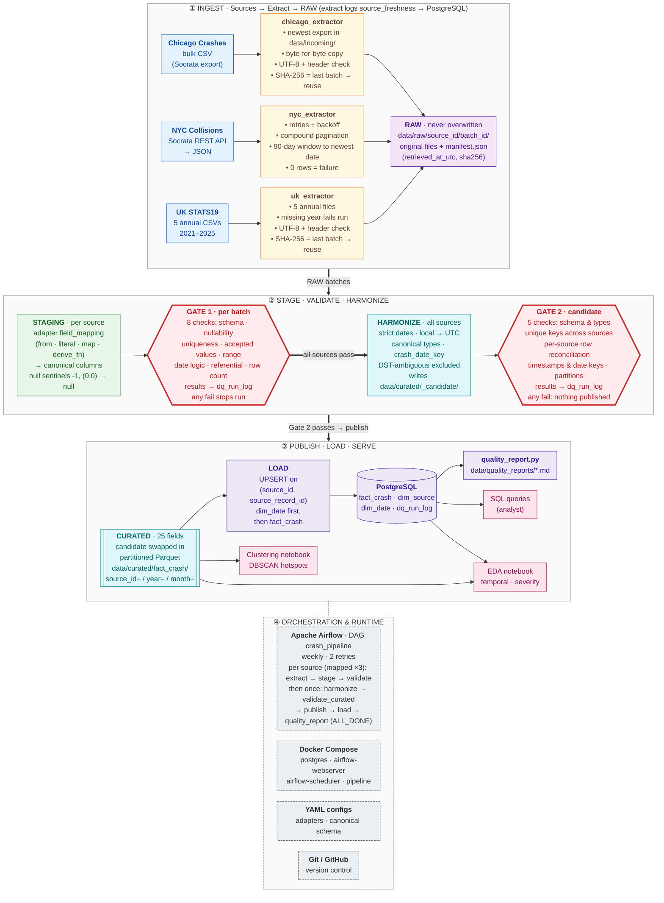
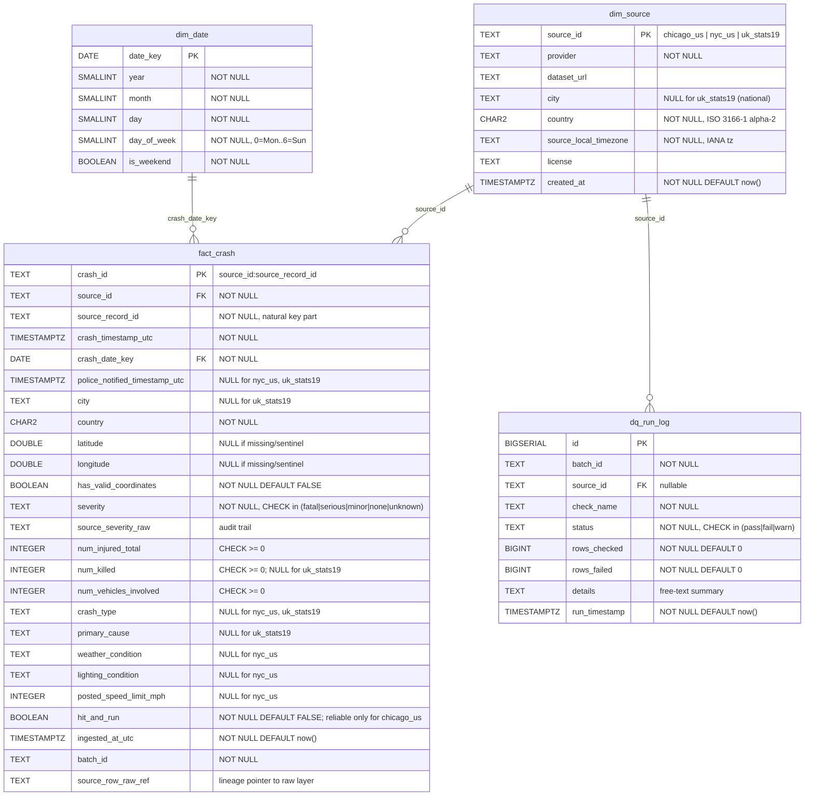

# Diagrams

Architecture, data-flow/lineage, and ERD diagrams for the cross-city road
crash data pipeline. Each diagram is authored as Mermaid source under
`docs/diagrams/` so it diffs cleanly in version control and can be
regenerated or exported to PNG/SVG for the final paper.

Rendered versions appear inline below via VS Code's Markdown Preview
Mermaid Support extension, and on GitHub when this file is viewed there.

---

## 1. Architecture

**Source:** [`diagrams/architecture.mmd`](diagrams/architecture.mmd)

Covers: sources → ingestion → raw → staging → validation → harmonization
→ curated gate → published Parquet → load → PostgreSQL → consumption, with Airflow as the
orchestration layer, Docker Compose as the runtime, YAML as config, and
Git as version control. Each box names the module that implements it.

**Reading this diagram:** Solid arrows are data flow; dashed arrows are
orchestration/runtime relationships (Airflow *schedules* the stages, it
is not itself a data stage).

- **File checks and freshness live in ingestion.** The Chicago and UK
  extractors confirm each file is readable UTF-8 with a header row, and
  compare its SHA-256 with the last raw batch: an unchanged file is not
  copied again and the previous batch is reused. NYC treats an empty API
  result as a failure. Each source writes a `source_freshness` row to
  `dq_run_log`, so every run records whether new data arrived.
- **Staging maps, validation gates.** `staging.py` applies each
  adapter's `field_mapping` and nulls sentinel values, leaving values as
  source-faithful text. `checks.py` then runs 8 checks per batch and
  writes every result to `dq_run_log`. Any `fail` stops the run before
  harmonization, so no partial data reaches curated or Postgres.
- **Harmonization runs once, across all sources, and is audited before
  anyone sees it.** `curated.py` reads the batches validated in this
  run, converts local time to UTC, casts types and writes a *candidate*.
  `curated_checks.py` then runs 5 checks on the combined result (schema
  and types, unique keys across sources, per-source row reconciliation,
  timestamps and date keys, partitions). Only if all pass is the
  candidate published to `data/curated/fact_crash/`; otherwise nothing
  is published or loaded (write-audit-publish). Date formats and types
  are set in code, not read from the YAML configs.
- **Postgres is loaded from the curated Parquet**, by an UPSERT on the
  natural key, so reruns update rows rather than duplicate them. The
  Parquet layer holds only the latest batch per source; Postgres keeps
  every batch ever loaded.
- **The quality report** summarizes the run's `dq_run_log` rows and runs
  even when an earlier stage failed.

---

## 2. Data Flow / Lineage

**Source:** [`diagrams/lineage.mmd`](diagrams/lineage.mmd)

Traces each canonical `fact_crash` field back to its source column(s)
across `chicago_us`, `nyc_us`, and `uk_stats19` (including UK `city`,
derived from the police force: "London" for Greater London), plus the
`batch_id` → raw batch folder → `manifest.json` traceability chain.
Structural nulls (fields a source cannot populate) are shown as dashed
paths, matching the gap matrix in `docs/data_dictionary.md`.

```mermaid
%%{init: {"flowchart": {"nodeSpacing": 20, "rankSpacing": 30, "padding": 8}}}%%
flowchart TB

    %% ═════════ HOW TO READ ═════════
    subgraph R0[" "]
        direction TB
        LEG["<b>Column lineage → fact_crash (canonical curated table)</b><br/>Each card: source fields (left) → canonical fields (right)<br/>✗ = source cannot populate this field · red dashed box = source has no field in this card<br/>Colors: <b>Chicago</b> blue · <b>NYC</b> amber · <b>UK STATS19</b> green"]
    end

    %% ═════════ ROW 1 · IDENTITY + TRACEABILITY ═════════
    subgraph R1[" "]
        direction TB

        subgraph G1["Identity"]
            direction LR
            I1["<b>Chicago</b><br/>CRASH_RECORD_ID"]
            I2["<b>NYC</b><br/>collision_id"]
            I3["<b>UK</b><br/>collision_index"]
            IC["<b>canonical</b><br/>crash_id = {source_id}:{source_record_id}<br/>source_record_id"]
            I1 --> IC
            I2 --> IC
            I3 --> IC
        end

        subgraph G2["Row-level traceability"]
            direction TB
            L1["<b>batch_id</b><br/>every fact_crash row carries<br/>batch_id + source_record_id"]
            L2["<b>data/raw/{source_id}/{batch_id}/</b><br/>original files<br/>record found by source_record_id"]
            L3["<b>manifest.json</b><br/>retrieved_at_utc · file list<br/>sha256 per file"]
            L1 --> L2 --> L3
        end
    end

    %% ═════════ ROW 2 · TIME + LOCATION ═════════
    subgraph R2[" "]
        direction TB

        subgraph G3["Time"]
            direction LR
            T1["<b>Chicago</b><br/>crash time: CRASH_DATE<br/>police notified: DATE_POLICE_NOTIFIED"]
            T2["<b>NYC</b><br/>crash time: crash_date + crash_time<br/>police notified: ✗ no field"]
            T3["<b>UK</b><br/>crash time: date + time (DD/MM/YYYY)<br/>police notified: ✗ no field"]
            TC["<b>canonical</b><br/>crash_timestamp_utc<br/>(local → UTC in curated.py)<br/>police_notified_timestamp_utc"]
            T1 --> TC
            T2 --> TC
            T3 --> TC
        end

        subgraph G4["Location"]
            direction LR
            O1["<b>Chicago</b><br/>coordinates: LATITUDE / LONGITUDE<br/>city / country: not mapped"]
            O2["<b>NYC</b><br/>coordinates: latitude / longitude<br/>city / country: not mapped"]
            O3["<b>UK</b><br/>coordinates: latitude / longitude<br/>city: police_force (1 Metropolitan,<br/>48 City of London) → uk_city() = London<br/>✗ null outside Greater London"]
            OC["<b>canonical</b><br/>latitude / longitude<br/>+ has_valid_coordinates<br/>city / country"]
            O1 --> OC
            O2 --> OC
            O3 --> OC
        end
    end

    %% ═════════ ROW 3 · SEVERITY + COUNTS ═════════
    subgraph R3[" "]
        direction TB

        subgraph G5["Severity"]
            direction LR
            V1["<b>Chicago</b><br/>severity + raw:<br/>MOST_SEVERE_INJURY"]
            V2["<b>NYC</b><br/>severity: nyc_severity() from<br/>injured + killed counts<br/>✗ cannot populate 'serious'<br/>raw: persons_injured + persons_killed<br/>(aggregate, ~88% null)"]
            V3["<b>UK</b><br/>severity + raw: collision_severity<br/>(1=fatal, 2=serious, 3=minor)"]
            VC["<b>canonical</b><br/>severity<br/>source_severity_raw"]
            V1 --> VC
            V2 --> VC
            V3 --> VC
        end

        subgraph G6["Counts"]
            direction LR
            N1["<b>Chicago</b><br/>injured: INJURIES_TOTAL<br/>killed: INJURIES_FATAL<br/>vehicles: NUM_UNITS"]
            N2["<b>NYC</b><br/>injured: number_of_persons_injured<br/>killed: Σ pedestrians + cyclist<br/>+ motorist killed<br/>vehicles: non-null count of<br/>vehicle_type_code1..5"]
            N3["<b>UK</b><br/>injured: number_of_casualties<br/>killed: ✗ no num_killed field<br/>vehicles: number_of_vehicles"]
            NC["<b>canonical</b><br/>num_injured_total<br/>num_killed<br/>num_vehicles_involved"]
            N1 --> NC
            N2 --> NC
            N3 --> NC
        end
    end

    %% ═════════ ROW 4 · DESCRIPTORS + CONDITIONS ═════════
    subgraph R4[" "]
        direction TB

        subgraph G7["Crash description"]
            direction LR
            D1["<b>Chicago</b><br/>crash_type: FIRST_CRASH_TYPE<br/>primary_cause: PRIM_CONTRIBUTORY_CAUSE<br/>hit_and_run: HIT_AND_RUN_I"]
            D2["<b>NYC</b><br/>crash_type: ✗ no field<br/>primary_cause: contributing_factor_vehicle_1<br/>hit_and_run: ✗ no field → defaults false"]
            D3["<b>UK</b><br/>crash_type: ✗ no field<br/>primary_cause: ✗ no field<br/>hit_and_run: ✗ no field → defaults false"]
            DC["<b>canonical</b><br/>crash_type<br/>primary_cause<br/>hit_and_run"]
            D1 --> DC
            D2 --> DC
            D3 --> DC
        end

        subgraph G8["Conditions"]
            direction LR
            W1["<b>Chicago</b><br/>weather: WEATHER_CONDITION<br/>lighting: LIGHTING_CONDITION<br/>speed limit: POSTED_SPEED_LIMIT"]
            W2["<b>NYC</b><br/>✗ no weather field<br/>✗ no lighting field<br/>✗ no speed_limit field"]
            W3["<b>UK</b><br/>weather: weather_conditions (-1 → null)<br/>lighting: light_conditions (-1 → null)<br/>speed limit: speed_limit (-1 → null)"]
            WC["<b>canonical</b><br/>weather_condition<br/>lighting_condition<br/>posted_speed_limit_mph"]
            W1 --> WC
            W2 -.->|"cannot populate"| WC
            W3 --> WC
        end
    end

    %% Keep rows stacked in a grid (invisible links between rows)
    R0 ~~~ R1
    R1 ~~~ R2
    R2 ~~~ R3
    R3 ~~~ R4

    %% ═════════ STYLES ═════════
    classDef chi   fill:#e3f2fd,stroke:#1565c0,color:#0d47a1
    classDef nyc   fill:#fff8e1,stroke:#f57f17,color:#5d4037
    classDef uk    fill:#e8f5e9,stroke:#2e7d32,color:#1b5e20
    classDef gap   fill:#ffebee,stroke:#c62828,stroke-dasharray:3 2,color:#b71c1c
    classDef canon fill:#e0f7fa,stroke:#00838f,stroke-width:2px,color:#006064
    classDef lin   fill:#f3e5f5,stroke:#6a1b9a,color:#4a148c
    classDef legend fill:#fafafa,stroke:#9e9e9e,color:#263238

    class I1,T1,O1,V1,N1,D1,W1 chi
    class I2,T2,O2,V2,N2,D2 nyc
    class I3,T3,O3,V3,N3,D3,W3 uk
    class W2 gap
    class IC,TC,OC,VC,NC,DC,WC canon
    class L1,L2,L3 lin
    class LEG legend

    %% Row wrappers invisible; group cards lightly outlined
    style R0 fill:none,stroke:none
    style R1 fill:none,stroke:none
    style R2 fill:none,stroke:none
    style R3 fill:none,stroke:none
    style R4 fill:none,stroke:none
    style G1 fill:#fafafa,stroke:#9e9e9e
    style G2 fill:#fafafa,stroke:#9e9e9e
    style G3 fill:#fafafa,stroke:#9e9e9e
    style G4 fill:#fafafa,stroke:#9e9e9e
    style G5 fill:#fafafa,stroke:#9e9e9e
    style G6 fill:#fafafa,stroke:#9e9e9e
    style G7 fill:#fafafa,stroke:#9e9e9e
    style G8 fill:#fafafa,stroke:#9e9e9e
```

**Reading this diagram:** Solid arrows are real field mappings from an
adapter YAML; arrows labelled with a function name (`nyc_severity()`)
are derived in `src/transform/derivations.py`. Dashed red arrows are the
structural gaps from `docs/data_dictionary.md` — fields a source does not
collect, not mapping omissions. NYC severity is a partial gap: it is
derived from injury and death counts, so it can be `fatal`, `minor` or
`none` but never `serious`. Blue = Chicago, amber = NYC, green = UK,
cyan = canonical `fact_crash`.

The purple band is the row-level lineage chain. Every `fact_crash` row
carries the `batch_id` of the run that last wrote it, which names its
raw folder `data/raw/{source_id}/{batch_id}/`; `source_record_id`
locates the record in that batch's files, and the batch's
`manifest.json` records when it was retrieved and each file's SHA-256.
(`source_row_raw_ref` exists in the schema for a future per-row pointer
but is not populated yet.)

---

## 3. Entity-Relationship Diagram (ERD)

**Source:** [`diagrams/erd.mmd`](diagrams/erd.mmd)

Derived from `sql/schema.sql`. Covers `dim_source`, `dim_date`,
`fact_crash`, and `dq_run_log`, with foreign keys, the
`uq_fact_crash_source_natural_key` UNIQUE constraint, and CHECK
constraints shown as annotations.

